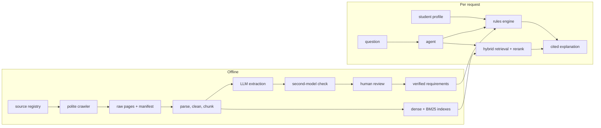

# Germany Master's Eligibility Assistant

> **Status: in development (Phase 3 of 12).** The data pipeline, retrieval core and requirement extraction with review are built, and all 13 programmes have verified requirement records. The eligibility report, agent, UI and public demo come in later phases. See [the project plan](docs/PROJECT_PLAN.md).

Applying for a master's in Germany means checking a dozen official websites: the programme page, uni-assist, APS, the embassy, the blocked-account rules, the city's foreigners' office. Each one says something slightly different, and some of it is only in PDFs. This project reads those official pages for you and answers from them, with a citation and a crawl date on every claim.

A student enters their profile and gets, for each programme:

- **which published requirements they meet, miss, or haven't provided yet**, with margins ("IELTS 6.5 vs 7.0 required, short by 0.5");
- **what to fix**;
- **the visa, financial-proof and arrival rules that apply**, plus matching scholarships.

When the sources don't cover a question, it says so instead of guessing.

**What it is not:** an admission predictor. There is no public data on who gets admitted, so any "72% chance" would be invented. It is also not official advice: always confirm with the university or embassy.

## Coverage

- **Country-wide rules** (APS, uni-assist, national visa, blocked account, health insurance, residence permit, job-seeker permit): answered for any German university, from DAAD, uni-assist, APS India, the Federal Foreign Office, BAMF and city service pages.
- **Full eligibility reports** for English-taught MSc programmes in CS, Data Science and AI. 8 universities and 13 programmes: TUM, RWTH Aachen, TU Berlin, Saarland University and TU Dresden (pilot), plus KIT, TU Darmstadt and the University of Stuttgart. More universities are added after launch; that is data work, not code.
- **Anything else** (another university, another country) gets an honest "not covered yet", the general rules, and a link to the official source. Requirements are never invented.

Germany only, on purpose: one country done properly beats three done badly. Every programme record is checked by hand.

## How it works



**The key design choice: the LLM never decides eligibility.** It extracts requirements from official pages, and every extracted record is checked against its cited official page before it is used. A deterministic rules engine compares the profile with those records. The LLM then only explains the result. So verdicts are reproducible, testable and explainable, and a prompt injection cannot change one.

### Built so far

- **Source registry**: every official URL, labelled by layer (country rules, scholarship, university), journey stage (before applying, visa document, visa and funds, arrival, after graduation), university and programme.
- **Polite crawler**:
  - respects robots.txt and refuses when it can't read it;
  - waits between requests to the same site;
  - follows and records redirects, and caps download size;
  - records a crawl date and a content hash for every page, so later re-crawls can spot changes.
  - Sites that block bots are dropped, not worked around.
- **Parsing**: HTML via BeautifulSoup, PDFs via pdfplumber, with tables kept as markdown. A structure-aware chunker splits on headings and fits the embedding model's 512-token limit. Every chunk carries its source's labels and crawl date, so retrieval can later filter by university or stage.
- **Hybrid retrieval**, all hand-written (no LangChain or LlamaIndex):
  - dense embeddings (bge-small) and BM25;
  - fused with Reciprocal Rank Fusion;
  - reranked with a cross-encoder (bge-reranker-base).
  - Every result carries its full score trace.
- **Grounded answers with a refusal gate**: if the best reranked evidence scores below a threshold, the system declines. Answers cite `[n]` markers mapped back to the source URL. Citation markers that point at no source are stripped.
- **Requirement extraction with human review** (`make extract`, `make review`):
  - an LLM reads each programme's official pages and fills a typed `ProgramRequirements` record: degree, credits, grade minimums, English and entrance tests (with the countries they apply to or exempt), German level, APS, deadlines, fees, documents;
  - every field is either "not published" or carries a verbatim quote and the page it came from, and a field whose quote is not in that page is dropped;
  - a second model from a different family cross-checks every field and may suggest a fix, which must pass the same quote check;
  - a local review screen shows each field next to its quote, the full page, automatic warnings and the cross-check verdict. Every field is confirmed against its quote and page before the record is saved as verified: six programmes by hand in this screen, the other seven by a second pass over the cited pages that saves through the same quote check. Verified records are both the product data and the evaluation gold set.
- **Evaluation harness**: a 4-way benchmark (vector, BM25, hybrid, hybrid+rerank) on Recall@k, MRR, nDCG and p50/p95 latency.
- **Observability**: request ids, structured JSON logs and per-stage latency.

### Coming next

Human verification of all 13 programmes → evaluation on a hand-checked gold set → eligibility rules engine → retrieval upgrades kept only if the numbers improve → small tool-using agent → streaming, guardrails and rate limits → UI → free public deployment → MCP server → UI polish. Details and the "done when" check for each phase are in [docs/PROJECT_PLAN.md](docs/PROJECT_PLAN.md).

## Benchmark

<!-- BENCHMARK:START -->
_PENDING — run `make eval` to populate._
<!-- BENCHMARK:END -->

Numbers appear once the gold question set is built (Phase 4).

## Run it locally

Python 3.12 is recommended (3.10+ supported). The first run downloads two models from Hugging Face (bge-small ~130MB, bge-reranker-base ~1.1GB). After that, everything except `make crawl` runs offline.

```bash
make install    # creates .venv and installs .[dev]
make crawl      # fetch every registry source into data/raw/ (the only network step; cached pages are skipped)
make ingest     # parse, clean and chunk -> data/processed/chunks.jsonl
make index      # dense (NumPy) + BM25 indexes
make extract    # LLM requirement drafts -> data/extracted/ (needs GEMINI_API_KEY)
make review     # review screen on http://127.0.0.1:8001 -> data/verified/
make test       # pytest (offline, uses its own fixture corpus)
make run        # API on :8000
```

Frontend (Node 18+):

```bash
cd frontend
npm install
npm run dev     # :5173, talks to the API on :8000
```

No API key is needed. Without one, answers come from an extractive fallback, which stitches together quoted sentences from the cited evidence. For the LLM path (Gemini, free tier) and `make extract`, copy `.env.example` to `.env` and set `GEMINI_API_KEY`. The free tier allows about 20 requests a day per model; `make extract` skips finished programmes, so re-running it the next day fills the gaps. All tunables live in `config/settings.yaml`.

Without Make (including Windows): `python -m venv .venv`, then `.venv/bin/python -m pip install -e '.[dev]'` (Windows: `.venv/Scripts/python.exe`). Optional CPU-only install: `make venv && uv pip install --python .venv/bin/python --torch-backend cpu -e '.[dev]'`.

`docker-compose.yml` (Qdrant + API + frontend) is a starting point for the containerised setup in Phase 8; hosting is not verified yet.

## Honest limitations (current)

- **Free-tier LLM quota.** About 20 requests a day per model, so extraction of many programmes takes more than one day and the hosted chat will need caching.
- **Small corpus, single node.** In-memory BM25 and brute-force cosine search. Fine for thousands of chunks, not millions.
- **No benchmark numbers yet.** The study-abroad gold set is built in Phase 4.
- **Official pages change.** Every answer shows its crawl date. A weekly re-crawl with human review of changed pages comes with deployment.
- **The extractive fallback is quotes, not prose.** It is grounded by construction but not fluent.
- **Answer groundedness is a token-overlap heuristic**, labelled as such. It is not an LLM judge.

## Privacy

Profiles will stay in the browser. The server is stateless and keeps no accounts and no personal data. Answers cite public official pages only.
