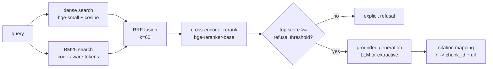

# EngineerDoc AI

I built this because most RAG demos fail in the same place — and it's not the
LLM. Naive RAG stuffs the top-3 cosine neighbours into a prompt and hopes.
When the answer quality is bad, it's almost always because *retrieval* handed
the model the wrong evidence: pure vector search misses exact identifiers
(`BackgroundTasks`, `--workers`), pure keyword search misses paraphrases, and
nothing checks whether the best hit is actually good enough to answer from.

So this project treats retrieval quality as the product. It's a hybrid RAG
service over technical documentation with a measured, reproducible answer to
the question "does each retrieval stage actually earn its latency?" — plus a
system that refuses to answer when the evidence is weak instead of
hallucinating.

## What it does

- **Hybrid retrieval:** dense embeddings (bge-small) + in-process BM25 with a
  code-aware tokenizer, fused with Reciprocal Rank Fusion (k=60), reranked
  with a cross-encoder (bge-reranker-base).
- **Grounded generation:** answers come only from retrieved evidence, with
  inline `[n]` citations mapped back to chunk id + URL. If the top rerank
  score is below a configurable threshold, the system returns an explicit
  refusal instead of guessing. Hallucinated citation markers are stripped.
- **Full trace observability:** every request gets a request id, structured
  JSON logs, per-stage latency, and per-chunk dense/bm25/RRF/rerank scores in
  the API response.
- **Reproducible evaluation:** a 4-way benchmark (vector-only / bm25-only /
  hybrid / hybrid+rerank) over a hand-labeled gold set, reporting Recall@k,
  MRR, nDCG@k, latency p50/p95 and answer groundedness.
- **Two-tab frontend:** Search (cited answers, score traces, refusal state)
  and an Evaluation Dashboard that renders the benchmark from static JSON —
  no backend needed to inspect results.
- Runs **fully offline**: committed sample corpus, local CPU models, NumPy
  vector store, extractive answer fallback. No API key, no Docker, no
  services required.

## Query path



## Benchmark

<!-- BENCHMARK:START -->
_PENDING — run `make eval` to populate._
<!-- BENCHMARK:END -->

## Setup (local, no Docker)

Use Python 3.12 for development, matching the API Docker image (the package
supports Python 3.10+). First run downloads two models from Hugging Face
(bge-small ~130MB, bge-reranker-base ~1.1GB) — after that everything is
offline.

```bash
make install                  # creates .venv and installs .[dev] into it
make ingest                   # sample corpus -> data/processed/chunks.jsonl
make index                    # dense (NumPy) + BM25 indexes
make eval                     # 4-way benchmark -> frontend/public/benchmark.json + table above
make test                     # pytest
make run                      # uvicorn on :8000
```

All Python Makefile targets use `.venv` directly, so activation is optional.
For direct Python commands, run `source .venv/bin/activate` first. To choose
another base interpreter, use `make install PYTHON=python3.12` on a fresh
checkout. `make venv` creates the environment without installing dependencies.

Without Make (including Windows PowerShell):

```bash
python3 -m venv .venv          # Windows: python -m venv .venv
# Linux/macOS:
.venv/bin/python -m pip install -e '.[dev]'
.venv/bin/python -m pytest -q
# Windows: use .venv/Scripts/python.exe instead of .venv/bin/python.
```

Dependencies are declared in `pyproject.toml`; the `dev` extra includes pytest,
HTTP test support, and Ruff (`make fmt`). `.venv` is local and disposable,
ignored by Git and excluded from Docker builds. Recreate it on each machine;
do not upload or copy it to a hosting server. Python dependency versions are
currently ranges, so installs are not yet locked to identical versions.

Optional CPU-only install with uv (avoids downloading CUDA dependencies for
this project's CPU models):

```bash
make venv
uv pip install --python .venv/bin/python --torch-backend cpu -e '.[dev]'
```

Frontend (needs Node 18+):

```bash
cd frontend
npm install
npm run dev                   # :5173, talks to the API on :8000
```

The Dashboard tab renders from `frontend/public/benchmark.json` and works
with no backend running at all.

Optional: copy `.env.example` to `.env` and set `OPENAI_API_KEY` to switch
answer generation from extractive mode to an LLM. Everything else works
without it.

### Docker phase (later)

`docker-compose.yml` wires Qdrant + API + frontend with healthchecks; the API
switches to the Qdrant backend via `VECTOR_BACKEND=qdrant`. Not needed for the
local run. Hosting uses a fresh environment built from `pyproject.toml`,
not your local `.venv`. The API image installs runtime dependencies only;
local development installs the additional `dev` tools.

Public hosting still needs deployment work: provision the API, frontend,
and Qdrant as appropriate for the chosen host, configure frontend API routing,
and arrange model downloads and persistent indexes. Ingest and index before
serving queries. The compose file is a starting point for container deployment;
public hosting has not been verified.

## Design notes

- All knobs (top_k, rrf_k, refusal_threshold, chunk sizes, models) live in
  `config/settings.yaml`, loaded once through pydantic. No magic numbers in
  code.
- The vector store is an interface with two implementations — NumPy
  brute-force (default) and Qdrant. Swapping is a one-line config change.
- The chunker is structure-aware: splits on headings, targets 512–1024
  tokens with ~12% overlap, and never splits inside a fenced code block.
- Answer groundedness is scored with a token-overlap heuristic and labeled as
  such everywhere it appears. It is not an LLM judge; don't read it as one.

## Honest limitations

- **Single node, small corpus.** In-memory BM25, brute-force cosine, no
  sharding. Fine for thousands of chunks, not millions.
- **Gold set is a seed.** 8 hand-written pairs prove the harness; conclusions
  need 30–60 (see `evaluation/datasets/README.md`).
- **Clean corpus assumption.** The parser handles tidy HTML/markdown. No OCR,
  no PDFs, no tables-in-images.
- **Extractive fallback is stitched quotes.** Readable and grounded by
  construction, but not fluent prose. The LLM path needs a key.
- **The overlap groundedness metric is generous** to extractive answers —
  they're built from evidence text, so it mostly validates the citation
  wiring, not deep factuality.

## v2 scale-up (when the corpus stops being cute)

In rough order of when they'd start paying rent:

1. **Index versioning + object storage** — rebuilds shouldn't drop traffic;
   store chunks/embeddings as versioned artifacts, swap atomically.
2. **Ingestion queue** — crawling and embedding move to workers (Celery/RQ)
   the moment ingestion takes longer than a request timeout.
3. **OpenSearch/Elasticsearch** replaces in-process BM25 once the index no
   longer fits comfortably in RAM or needs incremental updates.
4. **OCR + PDF parsing** when the corpus stops being clean HTML/markdown.
5. **Access control** (per-source ACLs filtered at retrieval time) the day
   two user groups shouldn't see the same documents.
6. **GPU or hosted embedding/rerank inference** once query volume makes CPU
   latency the bottleneck rather than a footnote.

---

## Resume bullets

- Built a hybrid-retrieval RAG service (dense + BM25 + RRF + cross-encoder
  rerank) with grounded, citation-mapped answers and threshold-based refusal;
  FastAPI + React, fully runnable offline on CPU.
- Designed a reproducible 4-way retrieval benchmark (Recall@k, MRR, nDCG,
  p50/p95 latency) over a hand-labeled gold set, rendered in a live
  evaluation dashboard.
- Instrumented the full pipeline with request-scoped structured logging and
  per-chunk score traces (dense/BM25/RRF/rerank) for end-to-end retrieval
  debuggability.

## 30-second pitch

"Most RAG failures are retrieval failures, so I built the retrieval story
properly: dense and BM25 candidates fused with reciprocal rank fusion, then a
cross-encoder reranks the top candidates, and the system refuses to answer
when its best evidence is weak instead of hallucinating. Every answer carries
citations that map back to real chunks, and — the part I care about most —
there's a reproducible benchmark comparing vector-only, BM25-only, hybrid,
and hybrid-plus-rerank on Recall, MRR and nDCG, so the architecture is
justified by numbers, not vibes. It's config-driven, observably logged, and
runs end-to-end offline on a laptop."
