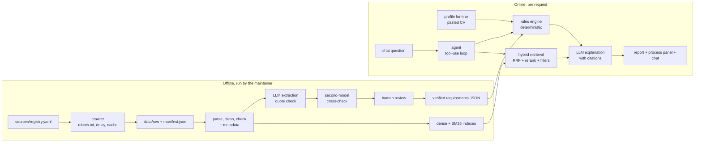

# Project plan: Germany admissions and eligibility assistant

Status: living document. Last updated 2026-10-16. Phases 1–2 are merged. Phase 3 (extraction, review, batch 2) is in progress: extraction, cross-check and review screen are built; batch 2 sources are registered and waiting to be crawled, extracted and verified.

**Build order:** 1 → 2 → 3 → 4 → **6 → 5** → 7 → 8 → 9 → 10 → 11 → 12. Phase 6 (eligibility engine) runs before Phase 5 (retrieval upgrades) because the engine is the product and needs only the verified records (decided 2026-10-13).

**Goal of the build:** a deployed, working system that proves real GenAI / RAG / LLM-systems skills on a CV, shipped as soon as possible without lowering data quality. A reviewer should find a live URL, a README with real evaluation numbers and an architecture diagram, a CI eval gate, an agent and an MCP server. Visual polish comes after deploy (Phase 12).

This repository started as EngineerDoc AI, a hybrid RAG service over technical documentation. It is being turned into an admissions and eligibility assistant for international students applying to master's programmes in Germany. The hand-written retrieval core is kept; the corpus, extraction, eligibility logic, agent, UI and deployment are new. `DECISIONS.md` records the reasoning behind each major choice.

## 1. The product

A student enters a profile. For a shortlist of German programmes the system shows:

- which published requirements they **meet, miss, or have not provided**, each with a citation;
- what to fix;
- the visa and financial-proof rules and the scholarships that apply.

The student can also chat freely. Every claim links to an official page and shows its crawl date. When a source does not cover a question, the system says so.

### Architecture (end state)



The LLM extracts and explains. The rules engine decides eligibility.

## 2. Key decisions

### 2.1 Why Germany only
This is a scope decision, stated once on the coverage page and in the README:

- The maintainer studies in Germany, so the sources and edge cases can be checked first-hand.
- The German system is rule-based (uni-assist, APS for some nationalities, a blocked account, grade conversion). It maps cleanly onto a deterministic rules engine, which is the core design choice of the project.
- Germany is one of the largest destinations for international master's students and most public universities charge little or no tuition (exceptions such as TUM and Baden-Württemberg's fees for non-EU students are exactly the kind of detail the report must cite).
- Depth beats breadth for a verified product: every programme record is checked by hand, so a few countries done badly would be worse than one done well.

A question about another country gets a coverage-aware refusal ("I currently cover Germany only") plus the official portal link. That behaviour is evaluated too. Adding a country later would mean new sources and a schema mapping; it is out of scope.

### 2.2 Eligibility report, not an admission probability
- **Not offered: a probability of admission.** There is no public admissions-outcome data, and selection committees change their criteria from year to year. A number like "72% chance" would be invented.
- **Offered: an eligibility and gap report against published requirements.**
  1. **LLM structured extraction.** Each programme page becomes a `ProgramRequirements` record: minimum grade and scale, required degree or field, ECTS/credit prerequisites, IELTS/TOEFL/Duolingo minimums, GRE/GMAT, APS, work experience, deadlines, fees, documents. Each field cites its source span.
  2. **Automatic checks.** A field survives only if its verbatim quote is found in the page it cites. A second model from a different family then cross-checks every field (correct / wrong / partial / missed / not published / unsure) and may propose a fix; a proposed fix must pass the same schema and quote check, or it is shown as invalid.
  3. **Human verification.** A review screen shows each field next to its quote, the full page, the automatic warnings and the cross-check verdict. Every field is ticked by hand before Save. The verified records are both the product data and the gold evaluation set.
  4. **Deterministic rules engine.** It compares the profile with the requirements. Each requirement returns `meets`, `does_not_meet`, `unknown` (missing info) or `not_published`. The LLM never decides eligibility; it only extracts and explains.
  5. **Deterministic tools** for grade conversion (the modified Bavarian formula) and test-score equivalence where officially published.
  6. **Competitiveness is qualitative and cited.** If a page says "typically admitted students have…", we quote it.
- **Numbers in the report, with no invented weights:**
  - A count: "6 of 8 published requirements met · 1 not met · 1 missing info".
  - A margin on every numeric criterion: "IELTS 6.5 vs 7.0 required → short by 0.5".
  - A hard/soft flag per requirement ("must" vs "recommended"). One unmet hard requirement makes the headline "Not eligible as published", whatever the count.
  - No weighted single score.
- **Scope:** master's programmes in CS, Data Science and AI. Requirements are per programme, so a fixed field keeps the workload bounded. Adding fields later is data work, not code.

### 2.3 The whole journey, not only admission
Visa rules are national but connect to the university at specific points. Each stage comes from official sources.

| Stage (`stage` in the registry) | Germany | University-specific link |
|---|---|---|
| Before applying (`before_applying`) | APS (some nationalities), uni-assist or direct application, language tests | Programme requirements and deadlines |
| Admission → visa document (`visa_document`) | Admission letter, national D visa application | The university issues the letter the visa depends on |
| Visa and funds (`visa_funds`) | Blocked account, health insurance | Fees and cost of living differ by university and city |
| Arrival and during study (`arrival`) | City registration (Anmeldung), residence permit, work-hour limits | City of the university |
| After graduation (`after_graduation`) | 18-month job-seeker residence permit, EU Blue Card route | Some depend on the degree |

- The **funds check** is a deterministic rule: the profile budget is compared with the required financial proof, with a margin and a citation.
- **Extensions and status changes** are answered as cited official procedure only, never as personal advice.
- **City-level offices** (for example foreigners' offices) are covered only for the cities of covered universities.

### 2.4 Profiles: no accounts, privacy by design
- The profile form covers nationality, degree, grade and scale, field, credits, language tests, GRE, work experience, budget and intake.
- A "paste your CV or profile" box fills the form via structured output. The user confirms or edits before anything is checked.
- The profile lives only in the browser (localStorage) and is sent with each request. The server is stateless: no auth, no database of personal data, no profile fields in logs. Profiles can be exported and imported as JSON.

### 2.5 "Show the whole process" view
Each request streams its steps (SSE) into a process panel with a "simple / show the work" toggle:

1. **Input understood**: each extracted profile field next to the phrase it came from, with a confidence score; low-confidence fields are flagged.
2. **Sources retrieved**: documents found, crawl dates, retrieval scores (the existing score trace on `RetrievedChunk`).
3. **Rules checked**: per criterion, your value → required value → verdict → citation.
4. **Explanation**: written answer pointing back to the rows above.

The form skips step 1; a pasted profile runs extraction first; a chat question goes through the agent's tool calls, each shown as a step.

### 2.6 User-typed text
Three kinds of user text, never mixed:

1. **Extra facts about themselves**: extracted into profile fields, confirmed, then checked.
2. **A source for a programme we do not cover: pasted text only, no URL fetching.** Used for that request only, never added to the corpus or cached, labelled "user-provided, not verified", and treated strictly as data (prompt-injection guardrails apply). This removes the SSRF surface and any dynamic scraper.
3. **"This answer is wrong" feedback**: stored only with explicit consent and without the profile (answer id, source id, note). It goes into a review queue; the maintainer checks it against the official page and fixes the verified data or the gold set.

## 3. LLM provider and deployment

### 3.1 LLM
The project uses the **Gemini free tier** (Google AI Studio key, no billing) through Gemini's OpenAI-compatible endpoint. `generation/llm_client.py` is the only module that touches the SDK, so the provider stays swappable. The endpoint (`models.llm_base_url`), model (`models.llm_model`) and the `GEMINI_API_KEY` variable were wired in Phase 3; with no key the app uses the extractive fallback.

- The key goes in `.env` as `GEMINI_API_KEY`. It is never committed or pasted into chat.
- Free-tier rate limits and model names change; re-check them at build and deploy time rather than hard-coding assumptions. Measured in October 2026: about 20 requests per day **per model**, about 1 minute per extraction call, and occasional 503 overloads. A fallback list (`models.llm_fallback_models`) moves to the next model on a 429. The deployed chat therefore needs response caching and the fallback list (Phase 8).
- Free-tier prompts may be used by the provider to improve its products. Public university pages are fine. **Do not send real personal profiles through it during development**, and say so in the privacy notice for the hosted demo.
- Cost control is request-based: a per-IP daily cap and a global daily request cap. When the cap is hit, the UI shows "demo quota reached".
- A small model handles extraction, routing and most answers; a stronger one is used only for hard multi-hop questions and the offline judge. Answers are cached.
- Extraction and the judge run once locally and results are committed as JSON. Deploys never re-run them.

### 3.2 Hosting (free)

| Part | Option | Notes |
|---|---|---|
| Frontend | Cloudflare Pages | Static hosting with a free subdomain. |
| Backend + models | Hugging Face Space (Docker, free CPU tier) | Sleeps when idle, so the first request is slow; the README says so. |
| Vector store | In-process NumPy (or Qdrant local mode) | A few thousand chunks fit in memory. |
| LLM | Gemini free tier | See 3.1. |

The reranker size is an evaluation decision: bge-reranker-base is measured against a smaller cross-encoder, partly for cold-start time. CORS is currently hard-coded to `localhost:5173` and must become configurable before deployment.

### 3.3 After launch
The app runs on the hosts and does not need a laptop. Updates are automated with one deliberate human step:

1. A weekly scheduled GitHub Action re-crawls every source and detects changes by content hash.
2. For changed pages it re-runs extraction and opens a pull request showing the page diff and changed fields.
3. The maintainer reviews and merges (about 10–20 minutes a week). Publishing an extracted visa or fee change without a human check is how a trusted tool starts giving wrong answers.
4. The merge triggers CI (tests, evaluation-regression gate, index rebuild) and, if green, auto-deploys.
5. Answers built on pages that failed to re-crawl or are older than N days are shown as "may be outdated".
6. Dependabot opens dependency PRs and a free uptime check pings the backend.

## 4. Security, privacy and EU considerations
Engineering due diligence, not legal advice; have a lawyer review it before any commercial use.

- **Data minimisation:** profiles stay in the browser; the server is stateless.
- **IP addresses are personal data under GDPR.** Rate limiting keeps hashed IPs in memory only (24 h or less), never on disk. Logs carry a request id, latency and usage, not IPs or profile fields.
- **No tracking cookies or analytics.** localStorage holds only what the user entered. A plain-language privacy notice page is included.
- **Third-party processors are disclosed:** request content is sent to the LLM provider; the hosting region is stated.
- **Feedback storage** is opt-in, contains no profile, can be deleted on request, and has a retention limit.
- **EU AI Act:** AI systems that determine access or admission to education are high-risk. This tool is a self-service information aid and makes no decision for any institution; the UI and README say so. Transparency duties are met: clearly labelled as AI, answers cite sources, and every report carries a "not official advice; confirm with the university or embassy" note.
- **Application security:** secrets only in host environment variables, secret scanning and dependency audit in CI, CORS locked to the frontend domain, input size limits, agent tools read-only (so injected text cannot trigger actions), PDF parsing size and page limits.
- **Content and licensing:** respect robots.txt and site terms. Sites that block bots (for example a "verify your browser" wall) are dropped, not worked around. Text is stored for retrieval but only short excerpts are shown, always with a link to the source.

## 5. Scope

**One milestone: Germany, taken end to end and deployed.** Country rules and journey stages, DAAD, uni-assist and APS, through all phases.

- **Pilot universities (5), Phase 2:** TUM, RWTH Aachen, TU Berlin, Saarland University, TU Dresden. The pipeline is built and checked on these first.
- **Pilot programmes (8):** TUM M.Sc. Informatics and M.Sc. Data Engineering and Analytics; RWTH M.Sc. Computer Science and M.Sc. Data Science; TU Berlin M.Sc. Computer Science; Saarland M.Sc. Computer Science and M.Sc. Data Science and Artificial Intelligence; TU Dresden M.Sc. Computer Science. `sources/registry.yaml` is the authoritative list.
- **Batch 2 (3 universities, 5 programmes), end of Phase 3:** KIT (M.Sc. Computer Science, M.Sc. Computational and Data Science), TU Darmstadt (M.Sc. Computer Science, M.Sc. Artificial Intelligence and Machine Learning), University of Stuttgart (M.Sc. Computer Science; its AI / Data Science master's is German-taught). Each was checked against the live site and robots.txt. The earlier candidates LMU, Bonn, Tübingen and Mannheim were cut on 2026-10-13 to reach deployment sooner; they are long-tail work.
- **Registry gap pages (Phase 3):** pages the pilot programmes link to but did not have: RWTH deadlines, international master's application, language rules and the per-programme language PDF; TUM language certificates.
- **Total after Phase 3:** 8 universities, 13 programmes, 72 sources.
  - **Why the end of Phase 3:** extraction and the review screen are proven on the pilots first, so adding a university is cheap. Batch 2 lands before the Phase 4 evaluation baseline, so the gold set, the Phase 5 ablations and the deployed demo all run on the corpus that ships. More universities also means more programme pages that read alike, which is where metadata filters and reranking have to prove their value.
- **Long tail:** further universities are data-only work after deployment (registry entries, crawl, extract, verify). No code changes.
- **Coverage tiers (what a user sees):**
  1. **Country rules** (APS, uni-assist, visa, blocked account, health insurance, residence permit, job-seeker permit) answer for any German university.
  2. **The full eligibility report** covers only verified programmes.
  3. **An uncovered programme or university** (for example Passau or Regensburg) gets a "not covered yet" notice, the tier-1 rules, a DAAD programme-database link and the paste-text unverified check. Its requirements are never invented.
  4. **Another country** gets "I currently cover Germany only" plus the official portal link.
- **No fragile scrapers.** Fetch registry URLs, cache raw HTML/PDF, convert to text, run LLM extraction over the text. Tables use pdfplumber. No per-site CSS selectors.

**Demo reliability:** the frontend pings `/health` on load and shows an honest wake-up status. 2–3 precomputed demo profiles ship as static JSON so a full report renders even when the backend is asleep or the quota is hit.

**UI:** Tailwind + shadcn/ui replace the plain CSS. Wireframes come before the UI phase; the process panel is the centrepiece; basic accessibility checks are kept.

## 6. Target structure

Each folder is tagged with the phase that builds or changes it.

```
sources/registry.yaml   every source URL + country, layer (rules|scholarship|university), stage, uni,
                        programme (2); manifest.json records each crawl (2)
ingestion/              registry loader, polite crawler (robots.txt, per-host delay, cache, crawl date,
                        content hash), HTML+PDF parsing, cleaner, chunker, metadata on every chunk (2)
extraction/             LLM -> ProgramRequirements (pydantic, every field cited), quote check,
                        review screen; drafts, cross-checks and verified JSON committed (3).
                        Scholarship schema deferred until the agent needs it (7)
eligibility/            profile schema, rules engine, grade conversion, funds check
                        (pure Python, fully unit-tested) (6)
retrieval/              hybrid core kept (dense + BM25 + RRF + rerank); add metadata filters,
                        query rewrite, parent-child (5)
agent/                  hand-rolled tool-use loop, step budget, refusal (7)
generation/             LLM client (OpenAI-compatible, Gemini base_url) (3), structured answers,
                        citations, guardrails (8)
evaluation/             retrieval gold, extraction accuracy, eligibility verdict accuracy on synthetic
                        profiles, refusal/coverage probes (4), judge-based faithfulness, cost/latency (8)
api/                    SSE streaming, rate limit + request cap, cache, tracing, usage per request (8)
frontend/               profile form + paste-to-fill, eligibility report, process panel, chat with
                        sources, coverage page, evaluation dashboard (9)
ops/                    Dockerfile, docker-compose (local), GitHub Actions (lint, tests, build, eval
                        gate) (8), deploy to HF Spaces + Cloudflare Pages, weekly re-crawl (10)
mcp_server/             MCP server exposing the agent's tools (search_sources, get_requirements,
                        check_eligibility, convert_grade, find_scholarships) (11, after deploy)
data/extracted/         LLM drafts, one per programme (3)
data/checked/           second-model cross-check per draft: the audit trail (3)
data/verified/          human-verified records: product data and gold data (3)
```

## 7. Phases

Each phase ends runnable and measured. A phase starts only when the previous one meets its "Done when" line and is committed. Rows are in build order (Phase 6 before 5).

| # | Phase | What gets built | Manual task | Concepts | Done when |
|---|---|---|---|---|---|
| 1 | Clean base | Done: reranker normalisation, test isolation, `vite-env.d.ts`, CI workflow, stale docs removed | — | — | Merged (PR #1) |
| 2 | Sources and ingestion | Source registry checked against live sites; polite crawler (robots.txt, cache, crawl date); HTML/PDF parsing; chunks with metadata; journey-stage sources, on the 5 pilot universities | Review the source list, confirm programmes, decide robots.txt / terms-of-use issues (~30 min); run `make crawl`, `make ingest`, `make index` | Crawling ethics, parsing, chunking, provenance | `make crawl/ingest/index` run clean; tests green; Phase 2 section in `LEARNING.md`. Merged (PR #2) |
| 3 | Extraction + batch 2 | Done: Gemini `base_url` + model fallback, `ProgramRequirements` with cited fields, `make extract` with quote check, second-model cross-check (`data/checked/`), review screen (`make review`). Remaining: registry gap pages + batch 2 (KIT, TU Darmstadt, Stuttgart) crawled, extracted, cross-checked | Run crawl/ingest/index/extract; **verify every record in `make review`** (~20–30 min per programme, 13 programmes) | Structured outputs, schema design, field-level accuracy, verification design | `ls data/verified \| wc -l` = 13 (all registry programmes) and committed; Phase 3 in `LEARNING.md`; PR open |
| 4 | Eval baseline | ~100 draft gold questions written from verified pages, ~40 synthetic profiles, refusal and coverage probes, first benchmark numbers with the four retrieval modes, extraction accuracy (LLM draft vs verified, cross-check precision) | Review/fix drafts, write ~20 questions (~2–3 h) | Recall, MRR, nDCG; gold sets; judge bias | `make eval` prints real numbers for all four modes and extraction accuracy |
| 6 | Eligibility engine | Profile schema, rules engine, grade conversion, funds check, hard/soft flags, margins, entrance-test country conditions, paste-to-fill | Write 5 realistic anonymised profiles and check verdicts | Deterministic logic vs LLM | Verdicts correct on the 5 profiles; engine fully unit-tested |
| 5 | Retrieval upgrades | Metadata filters first; query rewriting and parent-child only if time allows; ablation table; each kept only if the benchmark improves | Read results and decide what stays | Ablation method | Ablation table committed; only upgrades that beat the baseline remain |
| 7 | Small agent | Tool-use loop over the existing functions (search, get_requirements, check_eligibility, convert_grade; find_scholarships optional) with a step budget; compared with one-shot RAG on multi-hop questions | Try multi-part questions and try to break it | Agent loops, tool design | Agent beats one-shot RAG on the multi-hop eval subset |
| 8 | Production layer | SSE streaming, guardrails, response caching, rate and request caps, tracing as structured logs (no vendor), model fallback, user-source path, feedback queue, privacy notice, Docker, CI eval gate | Run the Docker setup and attempt prompt injections | LLMOps, security, containers | Docker run verified; injection attempts handled; CI gate green |
| 9 | Functional UI | Wireframes first (started during Phase 8), then a clean, working, plain UI: profile form, report, process panel, chat, coverage page, dashboard. No animation | Approve wireframes, give usability feedback | Streaming UIs, UX for AI | Wireframes approved; form, report, process panel and chat working |
| 10 | Deploy and showcase | HF Space and Cloudflare Pages config, weekly re-crawl workflow, README with real numbers, architecture diagram, `LEARNING.md` | Create accounts, add secrets, press deploy | Deployment, CI/CD, operations | Public URL serves a cited answer and an eligibility report |
| 11 | MCP server (after deploy) | MCP server exposing the agent's tools | Connect the server to an MCP client and try to break it | MCP, tool contracts | Same tools usable from an MCP client |
| 12 | UI polish (after deploy) | The user-friendly UI with animations, as its own design pass | Approve the wireframes and design | Interaction design | Polished UI deployed; no regression in the eval gate |

**One-time setup:** GitHub repo (done); Gemini API key in `.env` before Phase 3; Docker Desktop with WSL integration (done); Hugging Face and Cloudflare accounts before Phase 10; product name chosen before Phase 9; MCP client installed before Phase 11.

### The loop for every phase
1. **Kick off.** "Start Phase N" → a short brief: what gets built, what the maintainer must do, what "done" means.
2. **Build** in small steps, each leaving a test or check behind.
3. **Hands-on task** (the manual column above).
4. **Run it yourself** with the commands provided.
5. **Explain.** "Explain Phase N" → a walkthrough of how it works and why.
6. **Park the learning.** Append the phase's notes, 3–5 interview-style quiz questions and the owed `DECISIONS.md` entry to `LEARNING.md`. The maintainer writes the DECISIONS entries and takes the quizzes in one batch after Phase 10, before Phase 11; this does not gate the next phase.
7. **Commit.** "Commit Phase N": one branch and one PR per phase.

Other commands: "Continue Phase N, step X", "Pause, explain why X", "Status?", "I disagree with X because Y". New session: "Continue the project, Phase N".

## 8. Carried over from the earlier review
Items from the October review that still apply and are folded into the phases above:

- Reranker: explicit activation (done in Phase 1); recalibrate the refusal threshold with real scores (Phases 4–5).
- Cleaner: do not strip comments or collapse blank lines inside fenced code (Phase 2).
- Chunking: respect model token limits (bge-small: 512 tokens); keep parent context for display (Phases 2 and 5).
- Answer contract: reject or repair empty, uncited or invalid-citation LLM output; add refusal reasons (Phases 3 and 8).
- Evaluation: validate gold labels, add refusal probes, warm models before timing, report sample counts (Phase 4).
- Serving: readiness vs liveness on `/health`; rate limits and request deadlines; `/ingest` and `/evaluate` become admin or job-only (Phase 8).
- Tests: no test may write real data, README or benchmark files, or call a paid provider (Phase 1 started this).
- Deployment: same-origin or configurable API base and CORS; benchmark published as a build artifact, not an API write (Phase 10).

## 9. Skills covered

| Area | What gets built |
|---|---|
| Data engineering | Crawling, PDF/HTML/tables, provenance, freshness |
| Retrieval and RAG | Hybrid search, reranking, filters, rewriting, citations |
| LLM engineering | Structured extraction, schema validation, model routing |
| Agentic AI | Tool-use loop (Phase 7); MCP server after deploy (Phase 11) |
| Evaluation | Gold sets, judge, ablations, CI gate |
| LLMOps | Tracing, usage, caching, caps |
| Backend and DevOps | FastAPI, Docker, CI/CD, free deployment |
| Frontend | React UI |
| Responsible AI | No-advice framing, stateless privacy, honest limits |

## 10. Constraints
- No LangChain or LlamaIndex; the LLM SDK is used directly through the thin client.
- Settings stay in `config/settings.yaml`.
- Each feature leaves a runnable check or test behind.
- The LLM never makes the eligibility decision.

## 11. Verification (end state)
- `make test` and CI are green.
- `make crawl ingest index eval` produces non-PENDING numbers that the dashboard renders.
- Extraction accuracy and eligibility-verdict accuracy are reported against the verified gold data.
- The deployed URL serves a streamed, cited answer and an eligibility report for a pasted profile.
- After deploy (Phase 11): the MCP server works from an MCP client.

## 12. Open items
- Product name: to be chosen before Phase 9.
- Long tail of further German universities (LMU, Bonn, Tübingen, Mannheim first): after deploy.
- Content-hash noise: some pages change their raw hash without a text change; hash the cleaned text before the Phase 10 re-crawl relies on it.
- A cross-check file records no link to the draft it checked; it must be re-run after every re-extraction.
